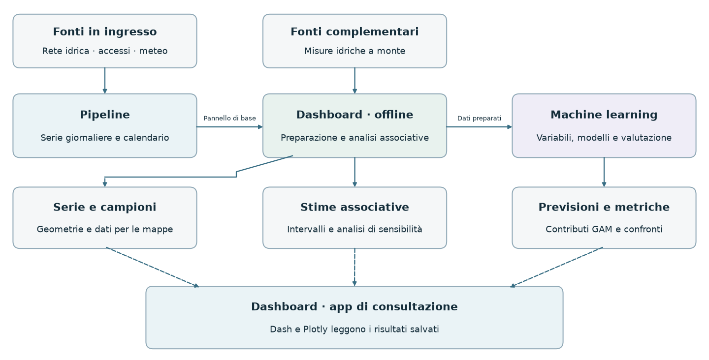

# NYC Water & Health Explorer

**[Visita il sito del progetto su GitHub Pages](https://unisalento-idalab-corsoperfez-25-26.github.io/perfez-2526-presentazione-semeraro/)**

## Progetto

Il progetto analizza la qualità dell’acqua e gli accessi in pronto soccorso
per diarrea e vomito a New York City. Usa misure della rete di distribuzione
e di due punti a monte, conteggi sanitari aggregati e dati meteorologici.

Le analisi rispondono a due domande. La prima riguarda l’associazione tra la
torbidità misurata in un giorno e gli accessi registrati sei giorni dopo.
La seconda valuta se aggiungere misure idriche riduce l’errore di previsione
rispetto alle informazioni già disponibili, per il giorno successivo e
per il totale dei sette giorni successivi.

## Architettura

Lo schema distingue la preparazione offline, che produce serie e risultati, dalla consultazione locale. Il componente Dashboard interviene in entrambe le fasi.

1. **Pipeline** prepara il pannello giornaliero e implementa i metodi
   per l’analisi associativa e le verifiche di sensibilità.
2. **Dashboard, preparazione offline** integra le misure a monte e produce
   i confronti associativi dedicati e le cache per la consultazione.
3. **Machine learning** costruisce i compiti predittivi, confronta i modelli
   con due riferimenti storici e salva predizioni, metriche e spiegazioni.
4. **Dashboard, consultazione** legge i risultati salvati e consente di
   esplorare le serie, le stime associative e i contributi alle previsioni GAM.

## Risultati principali

Nel confronto su 810 date primaverili comuni, la torbidità di rete è
associata a un aumento stimato dell’1,45% del conteggio atteso di accessi
per diarrea per ogni 0,1 NTU in più. La stima si attenua con una diversa
specificazione del trend temporale.

Nella valutazione retrospettiva, il GAM selezionato migliora entrambe le
baseline in tutti i compiti a un giorno. L’aggiunta di misure idriche
produce un beneficio variabile tra anni, compiti e configurazioni.

## Repository

- [Pipeline](https://github.com/UniSalento-IDALab-corsoPerfez-25-26/perfez-2526-nyc-pipeline-semeraro)
- [Machine learning](https://github.com/UniSalento-IDALab-corsoPerfez-25-26/perfez-2526-nyc-ml-semeraro)
- [Dashboard](https://github.com/UniSalento-IDALab-corsoPerfez-25-26/perfez-2526-nyc-dashboard-semeraro)
- [Presentazione del progetto](https://github.com/UniSalento-IDALab-corsoPerfez-25-26/perfez-2526-presentazione-semeraro)

## Pagina di presentazione

Apri [index.html](index.html) per consultare la pagina in locale. Presenta
metodo, risultati e fonti e collega i tre componenti. La schermata della
dashboard è un’immagine illustrativa.

Per GitHub Pages, usa come sorgente la radice del branch di consegna.
